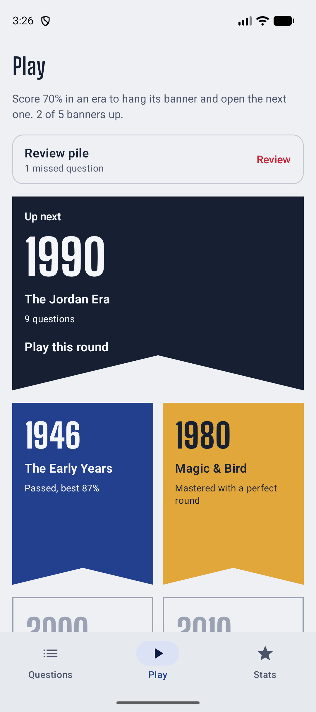
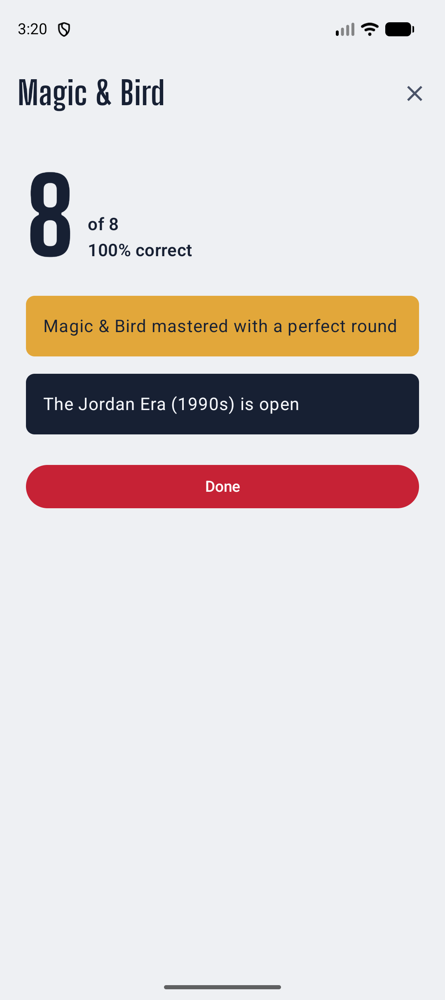
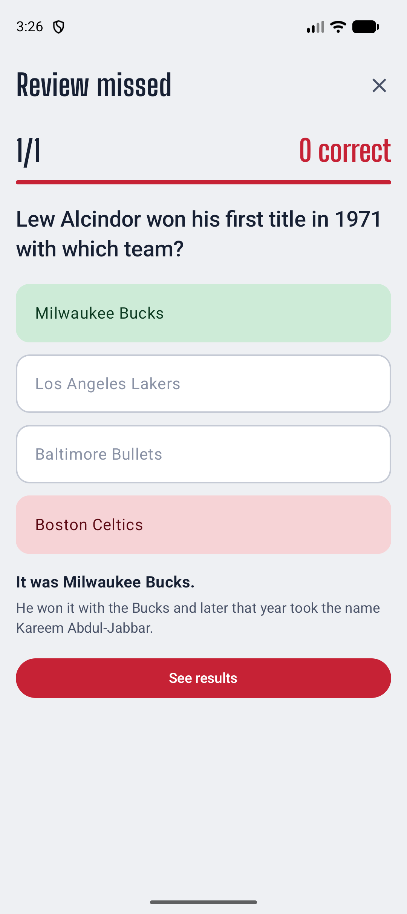
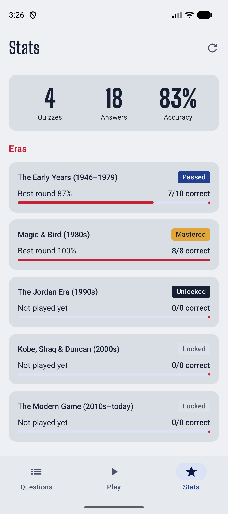

# Courtside Trivia: NBA History Quiz

An Android app (Kotlin, Jetpack Compose, Material 3) for testing what you know about NBA history. It has a question bank you can edit and five eras that unlock one by one as you play.

## Features

- **Question bank (CRUD).** 45 history questions are added on first launch, grouped by era in a `LazyColumn` with stable keys. You can add questions, edit them, and delete them after a confirmation dialog.
- **Validated form.** The form checks for a missing question, a question that is too short or too long, empty or duplicate answer options (ignoring case), a correct answer that hasn't been marked, and an explanation that is too long. Errors appear under each field once you tap Save.
- **Detail screen.** Shows the question, the correct answer, the "Did you know?" explanation and your record on it (times answered, accuracy, whether it's in the review pile).
- **Advanced feature: era progression and a review pile**
  - Only *The Early Years* is unlocked at the start. Scoring **at least 70%** in an era marks it **Passed** and unlocks the next one. A **100%** round marks it **Mastered** (Locked → Unlocked → Passed → Mastered).
  - Every answer is saved. A question you miss goes into the **review pile** and stays there until you answer it correctly **twice in a row**. The *Review missed* mode builds a quiz from that pile.
  - The results screen lists what changed in that round: an era passed or mastered, a new era unlocked, or questions cleared from the review pile.
  - Stats shows overall accuracy, accuracy and status for each era, your most-missed questions (tap one to open it) and the full quiz history. **Reset progress** (with a confirmation) clears the history and locks the eras again.
- **Empty states and feedback.** Each list has an empty state. Snackbars confirm adds, updates, deletes and resets. Leaving a quiz partway through asks for confirmation.

## Screenshots

The additional feature is era progression plus the review pile.

| Era banners | Round results |
|---|---|
|  |  |
| The Early Years is passed (blue), Magic & Bird is mastered (gold), the 1990s are up next, and the last two eras are still locked. One missed question waits in the review pile. | A perfect round masters Magic & Bird and opens The Jordan Era. |

| Review pile | Stats |
|---|---|
|  |  |
| A review round replays a question you missed. Answering it wrong again keeps it in the pile. | Accuracy for each era next to its status, built from the saved quiz history. |

## Design

Each era is a championship banner, like the ones hanging in an arena. A locked era is an empty outline, an unlocked one is navy, a passed one is royal blue, and a mastered one is gold. The next era to play gets the big banner at the top of the Play screen. Years, titles and scores use Big Shoulders Display, a condensed typeface first drawn for the City of Chicago; everything you read at length stays in the system font.

The banners, answer options and tags are custom components styled with the experimental Compose Styles API (`ui/theme/ComponentStyles.kt`). Era status and answer result are custom `StyleStateKey`s, so a banner or option changes its look from state alone, and pressing one animates through the style.

## Architecture

```
data/            domain models (Question, QuizMode, QuizAttempt…), progression rules, QuizRepository interface
data/local/      Room: entities, DAOs, TriviaDatabase (seeded on first create), RoomQuizRepository
ui/<screen>/     one ViewModel + one screen per feature: bank, detail, editor, play, quiz, stats
ui/components/   reusable composables (top bar, empty state, confirm dialog, pills, percent bar)
ui/navigation/   routes and bottom-navigation destinations
AppContainer     manual dependency injection, created once by TriviaApp
```

- **Room** has three tables: `questions`, `quiz_attempts`, and `answers`, which has foreign keys to both with cascade delete. Saving a finished quiz inserts the attempt and its answers in one `@Transaction`.
- **Flow everywhere.** The DAOs return `Flow`, and the repository maps and combines those flows (for example, era progress comes from questions + attempts). ViewModels expose them as `StateFlow` through `stateIn`, and screens collect them with `collectAsStateWithLifecycle()`. Any change on one screen (finishing a quiz, editing or deleting a question) shows up on every other screen without a manual refresh.
- **Unlock status is calculated, not stored.** It's worked out from the saved attempts, so it can't fall out of sync. Deleting a question, adding questions to an empty era, or resetting progress all update the unlocks.
- **State hoisting.** Screens are stateless apart from dialog visibility (`rememberSaveable`). All user actions go to ViewModel methods, and one-off results (saved, deleted, reset) arrive as events that the screen turns into navigation plus a snackbar.
- **Configuration changes.** Quiz progress, the selected answer and the form being edited all live in ViewModels, so rotating the screen keeps everything.

## Run

JDK 17+ is required (Android Studio's bundled JBR works).

```bash
./gradlew :app:installDebug        # build and install on a device/emulator
./gradlew :app:testDebugUnitTest   # unit tests: progression rules, review pile, form validation, milestones
```

minSdk 24, target/compile SDK 37.

Font: Big Shoulders Display by Patric King, SIL Open Font License 1.1 (from the google/fonts repository).
